# 🎓 التقرير التقني الشامل لمنظومة حاضر الأكاديمية الذكية
## Hadir LMS & Dynamic QR Attendance System (v2.1 Enterprise Edition)

---

### 📌 بطاقة تعريف المشروع والوثيقة
* **اسم المشروع:** مشروع حاضر (Hadir Academic LMS & Anti-Proxy Dynamic QR System)
* **المطور / المالك:** علي بن طاهر (`Ali-del-ux`)
* **تاريخ الاعتماد الأكاديمي والتقني:** نوفمبر 2026
* **مستوى الجاهزية:** إصدار الإنتاج الكامل (Production Ready - 0 Crashes Certified)
* **المستودع البرمجي الخاص (GitHub Private Repository):** [Ali-del-ux/Hadir](https://github.com/Ali-del-ux/Hadir)

---

## 📑 فهرس المحتويات
1. [الملخص التنفيذي وأهداف المشروع](#1-الملخص-التنفيذي-وأهداف-المشروع)
2. [المعمارية التقنية الشاملة (System Architecture)](#2-المعمارية-التقنية-الشاملة-system-architecture)
3. [الخوارزميات والأنظمة الهندسية المبتكرة (Core Algorithms)](#3-الخوارزميات-والأنظمة-الهندسية-المبتكرة-core-algorithms)
   - [3.1 خوارزمية كود الـ QR المتغير كل 20 ثانية (Dynamic Rotating QR)](#31-خوارزمية-كود-الـ-qr-المتغير-كل-20-ثانية-dynamic-rotating-qr)
   - [3.2 محرك الدرجات وفق معايير LMS العالمية (Moodle 4.0 Standard Engine)](#32-محرك-الدرجات-وفق-معايير-lms-العالمية-moodle-40-standard-engine)
   - [3.3 منظومة الرقابة المالية والتجميد الأكاديمي الفوري](#33-منظومة-الرقابة-المالية-والتجميد-الأكاديمي-الفوري)
   - [3.4 جدار الحماية والدفاع السيبراني النشط (OWASP Top 10 Active Defense)](#34-جدار-الحماية-والدفاع-السيبراني-النشط-owasp-top-10-active-defense)
4. [سجل التدقيق البرمجي وتثبيت استقرار الكود (Refactoring & Clean Code Log)](#4-سجل-التدقيق-البرمجي-وتثبيت-استقرار-الكود-refactoring--clean-code-log)
5. [دليل البيئة التجريبية والحسابات المعتمدة (Demo Accounts & Environments)](#5-دليل-البيئة-التجريبية-والحسابات-المعتمدة-demo-accounts--environments)
6. [إرشادات العرض ومناقشة التخرج (Graduation Defense Cheat-Sheet)](#6-إرشادات-العرض-ومناقشة-التخرج-graduation-defense-cheat-sheet)

---

## 1. الملخص التنفيذي وأهداف المشروع

تُعد منظومة **«حاضر»** حلاً برمجياً متقدماً مصمماً خصيصاً للمؤسسات الجامعية والأكاديمية، لمعالجة الفجوات الهيكلية في أنظمة إدارة التعلم (LMS) التقليدية وأنظمة التحضير اليدوية أو القائمة على بطاقات RFID أو رموز QR الثابتة.

### الأهداف الاستراتيجية للمنظومة:
1. **القضاء الجذري على ظاهرة الحضور الوهمي (Proxy Attendance):** من خلال كود مشفر يتجدد كل 20 ثانية ويرتبط بالبصمة الرقمية لجهاز الطالب.
2. **حوكمة العملية التعليمية والتقييم الأكاديمي:** تطبيق معايير Moodle 4.0 بحساب المعدل التراكمي (4.0 GPA) وضبط توازن أوزان الاختبارات والواجبات إلى 100% جبرياً.
3. **التكامل المؤسسي بين الشؤون الأكاديمية والمالية:** توفير ربط فوري يحظر تسجيل الحضور تلقائياً للطلاب المجمدين مالياً دون تدخل بشري يدوي مع إصدار إيصالات دفع إلكترونية معتمدة.
4. **الحصانة السيبرانية العالية:** تفعيل دفاع استباقي يقي المنظومة من ثغرات OWASP Top 10 ويحمي الخوادم من هجمات الحقن ورفع الملفات الخبيثة وتزييف الطلبات.

---

## 2. المعمارية التقنية الشاملة (System Architecture)

بُنيت منظومة حاضر وفق معمارية متعددة الطبقات (Multi-Tier Clean Architecture) تفصل بين منطق العرض، ومنطق الأعمال، وطبقة البيانات، وطبقة الأمان، لضمان استقلالية الوحدات وقابليتها للتوسع والاختبار.

```mermaid
flowchart TD
    subgraph ClientLayer["1. طبقة العميل والواجهات (Presentation Layer)"]
        UI_Student["بوابة الطالب (Student Portal)\n- مسح الـ QR التفاعلي\n- كشف الدرجات المعتمد GPA\n- السجل المالي وسندات الدفع"]
        UI_Teacher["بوابة المحاضر (Teacher Portal)\n- شاشة العرض (Projector 20s QR)\n- دفتر درجات Moodle 4.0\n- رصد الحضور والتظلمات"]
        UI_Admin["لوحة الإدارة (Admin Dashboard)\n- حوكمة المقررات والقاعات\n- إدارة المستخدمين وإعادة ضبط المرور\n- الشؤون المالية وتجميد الحسابات\n- مركز الأمان السيبراني وسجلات التدقيق"]
    end

    subgraph GatewayLayer["2. بوابة الأمان وتوجيه الطلبات (API & Security Gateway)"]
        ViteProxy["Vite Reverse Proxy (Port 8091)"]
        HelmetMiddleware["Helmet Security Headers & Strict CORS"]
        RateLimiter["Rate Limiting & DDoS Prevention"]
        AuthMiddleware["JWT Authenticator & Token Family Validator"]
        RBAC["Role-Based Access Control (Admin / Teacher / Student)"]
    end

    subgraph CoreBackend["3. الخادم والمنطق البرمجي (Backend Core - Port 3000)"]
        QR_Engine["Dynamic 20s QR Engine (HMAC-SHA256)"]
        Grade_Engine["Moodle 4.0 Weighted GPA Engine"]
        Finance_Engine["Financial Ledger & Suspension Rules"]
        Threat_Engine["In-Memory Active Defense & Risk Scoring"]
        Audit_Logger["Centralized JSONL Audit Logger"]
    end

    subgraph DataStorage["4. طبقة البيانات والخدمات السحابية"]
        MySQL_DB[("قاعدة بيانات MySQL 8.0\n- استعلامات معيارية مجهزة\n- معاملات ذرية Transactions")]
        Mock_Engine["خادم المحاكاة التفاعلي (In-Memory Engine)\n- دعم العرض الأوفلاين الفوري\n- 0 External DB Dependencies for Demos"]
        PDF_Service["محرك التقارير (Reports & PDF Service)"]
        Uploads_Store["مستودع الملفات المعزول (Secure Storage)"]
    end

    ClientLayer --> ViteProxy
    ViteProxy --> HelmetMiddleware
    HelmetMiddleware --> RateLimiter
    RateLimiter --> AuthMiddleware
    AuthMiddleware --> RBAC
    RBAC --> CoreBackend
    CoreBackend --> DataStorage
```



### حزمة التقنيات المستخدمة (Technology Stack):
* **الواجهة الأمامية (Frontend):**
  * **Framework:** React 18 مع TypeScript للموثوقية العالية وتفادي أخطاء وقت التشغيل (Runtime Type Safety).
  * **Build Tool:** Vite 7 فائقة السرعة مع هوك تجميع مخصص.
  * **Styling & UI:** Tailwind CSS v3، مخصصة بوضع ليلي عالي التباين (High-Contrast Slate/Navy `#090D16`)، ومكتبة الأيقونات العالمية Lucide React.
  * **In-Memory Demo Engine:** `mockServerPlugin.ts` مدمج بـ Vite لتشغيل كامل الوظائف الأكاديمية والمالية والأمنية دون الحاجة لخادم MySQL محلي أثناء العرض والمناقشة.
* **الخادم والباكند (Backend API):**
  * **Runtime:** Node.js v20 LTS مع Express framework مكتوب بـ TypeScript بالكامل.
  * **Validation:** مكتبة `Zod` الصارمة لتعقيم وفحص كافة المدخلات الواردة قبل معالجتها.
  * **Authentication:** رموز JWT ذات العمر القصير (15 دقيقة) مع رموز تجديد مشفرة (Opaque Refresh Tokens) وخاصية إبطال عائلة التوكن (Token Family Invalidation).
  * **Cryptography:** بروتوكول HMAC-SHA256، خوارزمية RFC 6238 لتوليد الرموز الزمنية، وتجزئة كلمات المرور عبر `bcryptjs` بـ 12 Salt Rounds.
* **البيانات ومحركات الطباعة:**
  * **Database:** MySQL 8.0 مع مكتبة `mysql2/promise` المدعومة بالاستعلامات المجهزة (Parameterized Queries).
  * **Reports Service:** ميكروسيرفيس مستقل يعتمد على `Puppeteer` و `PDFKit` لتوليد الكشوفات الرسمية وشهادات الإنجاز.

---

## 3. الخوارزميات والأنظمة الهندسية المبتكرة (Core Algorithms)

### 3.1 خوارزمية كود الـ QR المتغير كل 20 ثانية (Dynamic Rotating QR)
للقضاء التام على التحضير بالنيابة ومنع التقاط لقطات شاشة (Screenshots) أو إرسال الرمز عبر تطبيقات المراسلة:
1. **التشفير الزمني (TOTP Time-Step Algorithm):**
   * يتم تقسيم الزمن الحالي إلى نوافذ زمنية ثابتة:
     $$\text{Time Step Index} = \left\lfloor \frac{\text{Current Epoch Time (s)}}{20} \right\rfloor$$
   * يُحسب التوقيع المشفر لكل نافذة زمنية بواسطة:
     $$\text{Token} = \text{HMAC-SHA256}(\text{Lecture\_Secret\_Key}, \text{Session\_ID} \parallel \text{Time Step Index})$$
2. **معالجة انزلاق الوقت (Clock Drift Tolerance):**
   * تسمح الخوارزمية بنافذة سماح قدرها $\pm 1$ خطوة زمنية فقط (أي 20 ثانية قبل أو بعد) لتعويض أي فارق طفيف بين ساعة هاتف الطالب وساعة خادم العرض.
3. **نظام منع الحضور بالنيابة وبصمة الجهاز (Anti-Proxy Device Fingerprinting):**
   * عند مسح الرمز، يستخرج الخادم بصمة الجهاز (Browser Fingerprint + User Agent + Canvas Hash + Local Session Identifier).
   * يُمنع منعاً باتاً تسجيل طالبين مختلفين للحضور من نفس الجهاز أو المتصفح خلال نفس الجلسة، حتى لو قام أحدهما بتسجيل الخروج والدخول بحساب زميله.

---

### 3.2 محرك الدرجات وفق معايير LMS العالمية (Moodle 4.0 Standard Engine)
تم تصميم محرك الرصد والدرجات (`gradeEngineService.ts`) ليعمل وفق القواعد الأكاديمية الصارمة:
1. **قاعدة الـ 100% الإلزامية لتوزيع الأوزان:**
   * يرفض النظام حفظ أي مقرر أكاديمي أو فتح رصد درجاته إلا إذا كان مجموع أوزان التقييمات:
     $$\sum (\text{Assignments} + \text{Quizzes} + \text{Midterm} + \text{Practical} + \text{Final}) = 100\%$$
2. **احتساب المعدل التراكمي الفصلي والعام (Weighted 4.0 GPA):**
   * تُحول النسب المئوية إلى نقاط من 0.0 إلى 4.0 وفق معيار السلم المعتمد:
     $$\text{GPA} = \frac{\sum (\text{Grade Points}_i \times \text{Credit Hours}_i)}{\sum \text{Credit Hours}_i}$$
3. **معالجة الحالات الحدية والدرجة صفر (Zero-Grade Safe Evaluation):**
   * تم تصحيح الفحص المنطقي في الخادم والواجهة ليقبل رصد الدرجة صفر (`0`) كدرجة مستحقة للغياب أو الرسوب، دون معاملتها كـ `falsy value` تتجاهل الحفظ.

---

### 3.3 منظومة الرقابة المالية والتجميد الأكاديمي الفوري
* **الربط المالي الأكاديمي:** ترتبط بطاقة الطالب الأكاديمية بالسجل المالي في قاعدة البيانات.
* **التجميد التلقائي (Automatic Suspension):**
  * إذا وُجدت متأخرات مالية مستحقة تجاوزت المهلة المحددة، يُغير حقل `is_suspended` إلى `true`.
  * عند محاولة الطالب مسح كود الـ QR أو تسليم واجب، يقوم الـ Middleware بفحص فوري للحالة:
    * يُحظر تسجيل الحضور برمز استجابة مخصص `403 Account Suspended`.
    * تظهر واجهة الطالب تنبيهاً أحمر واضحاً يوضح سبب الإيقاف والمبلغ المستحق وإمكانية التوجه لقسم الشؤون المالية أو استخدام بوابة الدفع.
* **إيصالات القبض الإلكترونية:**
  * عند سداد أي دفعة، يُنشأ سجل دفع برقم إيصال فريد (Receipt ID) ورمز تحقق مشفر، مع إلغاء التجميد فورياً بنمط تركيبي ذري (Atomic DB Transaction).

---

### 3.4 جدار الحماية والدفاع السيبراني النشط (OWASP Top 10 Active Defense)
1. **OWASP A01: Broken Access Control:**
   * فرض التحقق الثنائي من الصلاحيات: ليس فقط التحقق من دور المستخدم (`authorize(ROLES.TEACHER)`)، بل التحقق البرمجي الدقيق من ملكية المقرر:
     `SELECT id FROM courses WHERE id = ? AND teacher_id = ?`
   * حظر ثغرات IDOR تماماً؛ لا يمكن لأي أستاذ الاطلاع على دفاتر درجات أو حضور طلاب أستاذ آخر.
2. **OWASP A02: Cryptographic Failures:**
   * تشفير كلمات المرور باستخدام `bcrypt` مع 12 دورة تمليح.
   * مصادقة ثنائية حقيقية (2FA) متوافقة مع تطبيق Google Authenticator باستخدام خوارزمية RFC 4648 Base32 Secret و RFC 6238 TOTP، مع معالجة كافة الأخطاء السابقة في تنسيق Hex.
3. **OWASP A03: Injection & Parameter Tampering:**
   * استخدام استعلامات SQL المجهزة (Parameterized Prepared Statements) في 100% من استعلامات قاعدة البيانات.
   * إخضاع كافة البيانات الداخلة لتعقيم وتحقق صارم بواسطة `zod schemas`.
4. **OWASP A08: Software & Data Integrity Failures:**
   * فحص الملفات المرفوعة بالتحقق من الـ Magic Numbers للترويسة (وليس فقط الامتداد)، لمنع رفع سكربتات PHP أو ملفات تنفيذية تتنكر في هيئة صور أو مستندات PDF.
   * كشف ومنع ملفات الـ Macro الخبيثة المضمنة في مستندات أوفيس.

---

## 4. سجل التدقيق البرمجي وتثبيت استقرار الكود (Refactoring & Clean Code Log)

تمت مراجعة وتدقيق كامل الملفات البرمجية بالمنظومة، وإصلاح الثغرات بدقة متناهية وفق مبادئ **Clean Code** و **SOLID Principles**:

| # | الملف البرمجي | المشكلة المعمارية السابقة | الإصلاح المطبق (Clean Code) | النتيجة المحققة |
| :--- | :--- | :--- | :--- | :--- |
| **1** | `Backend/src/routes/securityRoutes.ts` | 1. استعلام `SELECT password` بدلاً من `password_hash`<br>2. مفتاح 2FA بتنسيق Hex غير متوافق مع تطبيقات المصادقة | • استعلام الحقل المعتمد `password_hash` مع مطابقة التجزئة عبر bcrypt<br>• تطبيق خوارزمية RFC 4648 Base32 و RFC 6238 TOTP | تفعيل المصادقة الثنائية 2FA وإلغاؤها بدقة قياسية |
| **2** | `Backend/src/routes/reportsRoutes.ts` | انعدام صلاحيات RBAC وفحص الملكية (إمكانية تعديل الطلاب لدرجات زملائهم) | إضافة وسيطات التحقق `authorize(ROLES.ADMIN)` و `authorize(ROLES.TEACHER)` مع التحقق من تبعية المقرر | سد ثغرة Broken Access Control وحماية درجات الطلاب |
| **3** | `Backend/src/routes/assignmentRoutes.ts` | رفض رصد الدرجة صفر `0` بسبب فحص القيمة غير الدقيق `!gradeData.grade` | تعديل الفحص الشرطي ليكون: `gradeData.grade === undefined \|\| gradeData.grade === null` | رصد درجات الصفر والحالات المستحقة بسلاسة كاملة |
| **4** | `Backend/src/services/gradeEngineService.ts` | رصد الدرجات دون التحقق من أن المعلم الحالي يدرس هذا المقرر (ثغرة IDOR) | إضافة فحص شرطي صارم للملكية: `SELECT id FROM courses WHERE id = ? AND teacher_id = ?` | منع أي معلم من التعديل على مقررات زملائه |
| **5** | `Backend/src/schemas/user.schema.ts` & `UserManagement.tsx` | تباين في مسمى الحقل بين الواجهة (`newPassword`) ومخطط Zod (`password`) مسبباً خطأ 400 | دعم كلا الحقلين في الـ Schema ومطابقتها بالتوافق العكسي | نجاح عمليات تغيير وإعادة ضبط كلمات المرور فورياً |
| **6** | `Backend/src/routes/attendanceRoutes.ts` & `attendance.schema.ts` | استيراد Zod schemas دون تفعيلها بوسيطة التحقق `validateRequest` | ضبط الحقول المطلوبة وتفعيل `validateRequest` لإنشاء الجلسات والمسح | حماية المدخلات وتعقيمها قبل الوصول لقاعدة البيانات |
| **7** | `Backend/src/routes/healthRoutes.ts` | تكرار إنشاء وحذف ملفات مؤقتة على القرص عند كل فحص صحة الخادم | استبدال العمليات بـ `fs.accessSync` Idempotent عالي الكفاءة | تسريع استجابة فحص الصحة وحماية القرص الصلب |
| **8** | `Backend/src/server.ts` | ملف مسارات المحاضرين `teacherRoutes.ts` كان كوداً ميتاً غير مستدعى | استيراد المسار رسمياً وربطه بالبادئة `/api/teacher` | معمارية مسارات متكاملة ونظيفة |
| **9** | `ReportsService/debug_500.js` | خطأ في اسم جدول الحضور `FROM attendance` مسبباً خطأ 500 Crash | تصحيح الاستعلام إلى `attendance_sessions` و `session_id` | استقرار خدمة استخراج التقارير دون أخطاء في الـ SQL |
| **10** | `eduflow-portal-main/vite.config.ts` | غياب توجيه البروكسي لتحميل الملفات المرفوعة `/uploads` | إضافة قاعدة Proxy متكاملة لربط المنفذ 8091 بالمنفذ 3000 | تحميل الملفات والواجبات المرفوعة بسلاسة وبلا CORS |

---

## 5. دليل البيئة التجريبية والحسابات المعتمدة (Demo Accounts & Environments)

تم تجهيز النظام ليعمل في بيئتين متكاملتين:
1. **البيئة المباشرة المستقلة (In-Memory Standalone Demo):** تعمل عبر `mockServerPlugin.ts` في الواجهة الأمامية مباشرة على منفذ `8091`، وتسمح بعرض كافة المزايا والدرجات والحضور والمالية والتجميد دون الحاجة لأي خادم خارجي أو قاعدة بيانات معقدة أثناء مناقشة التخرج.
2. **البيئة الخادومية الكاملة (Full-Stack Mode):** خادم Express على منفذ `3000` متصل بقاعدة بيانات MySQL 8.0.

### الحسابات المعتمدة الجاهزة للاختبار:
```markdown
+------------------+---------------------+-------------------+-----------------------------------------+
| الدور (Role)     | الاسم التجريبي       | البريد الإلكتروني | أبرز الوظائف المتاحة                   |
+------------------+---------------------+-------------------+-----------------------------------------+
| طالب (Student)   | علي بن طاهر         | student1@test.com | مسح الـ QR، كشف الدرجات 3.88، الإيصالات |
| محاضر (Teacher)  | د. أحمد علي البشير   | teacher@test.com  | شاشة الـ 20s QR، دفتر درجات Moodle 4.0  |
| إدارة (Admin)    | مدير النظام الأكاديمي| admin@hadir.edu   | إدارة المقررات، التجميد المالي، الأمان  |
+------------------+---------------------+-------------------+-----------------------------------------+
كلمة المرور الافتراضية لكافة الحسابات التجريبية: Password123!
```

---

## 6. إرشادات العرض ومناقشة التخرج (Graduation Defense Cheat-Sheet)

لتحقيق أقصى درجات الإبهار أمام لجنة التحكيم والمشرف الأكاديمي خلال 5 دقائق فقط:

* **الدقيقة 1: تسجيل الدخول السلس ومفهوم الحل:**
  * افتح الواجهة على `http://localhost:8091`.
  * استعرض سلاسة التبديل بين أدوار النظام بنقرة زر من خلال التبديل السريع.
* **الدقيقة 2: شاشة البروجكتر وكود الـ QR المتغير:**
  * سجل الدخول كـ **محاضر**.
  * افتح **جلسة حضور جديدة** واضغط **«شاشة العرض (البروجكتر)»**.
  * أشر للعداد التنازلي للـ 20 ثانية، واشرح للجنة كيف تحمي خوارزمية HMAC-SHA256 المنظومة من الحضور الوهمي ولقطات الشاشة.
* **الدقيقة 3: دفتر درجات Moodle وسجل الطالب:**
  * سجل الدخول كـ **طالب** (علي بن طاهر).
  * اعرض **كشف الدرجات الأكاديمي المعتمد**، والمعدل التراكمي (GPA = 3.88).
  * اضغط زر **«طباعة الوثيقة الرسمية»** لتظهر وثيقة الدرجات الممهورة بختم الجامعة ورمز التحقق الرقمي.
* **الدقيقة 4: لوحة الإدارة والرقابة المالية والتجميد:**
  * سجل الدخول كـ **مدير النظام**.
  * اعرض ميزة **تجميد الحسابات للمتأخرين مالياً**، وكيف يمنع النظام حضور الطالب آلياً حتى سداد القسط وتوليد إيصال القبض.
* **الدقيقة 5: خلاصة الأمان السيبراني:**
  * اختم بتوضيح معايير OWASP المطبقة والمصادقة الثنائية وسجلات التدقيق المكتملة.

---

<div align="center">
  <b>تم بحمد الله وتوفيقه إعداد هذا التقرير وتوثيق المنظومة وفق أعلى المقاييس الهندسية البرمجية.</b>
</div>
